<picture>
  <source media="(prefers-color-scheme: dark)" srcset="https://raw.githubusercontent.com/Clufy/Clufy/main/.github/assets/hero-dark.svg">
  <source media="(prefers-color-scheme: light)" srcset="https://raw.githubusercontent.com/Clufy/Clufy/main/.github/assets/hero-light.svg">
  
</picture>

  
  
  

<table>
<tr>
<td width="176" valign="top"></td>
<td valign="top">

## Hi, I'm Aquib Haq

**AI engineer and backend engineer in Karachi, Pakistan**, building **AI and security tooling in Python and TypeScript**: RAG systems, LLM gateways, voice-agent SDKs and PII redaction. I ship libraries with typed APIs, CI, docs and real test coverage, and I care about systems that fail loudly instead of guessing.

Currently building at **[Zairen](https://zairen.co)**. Open to **AI Engineer, Backend Engineer and Applied ML** roles, remote or hybrid.

</td>
</tr>
</table>

## Featured projects

<table>
<tr>
<td width="50%" valign="top">

**[spanguard](https://github.com/Clufy/spanguard)** · PII/PHI detection and redaction for Python 
[PyPI](https://pypi.org/project/spanguard/) · 97% coverage · mypy strict · audit records that never hold raw values · [docs](https://clufy.github.io/spanguard/)
</td>
<td width="50%" valign="top">

**[voxbridge](https://github.com/Clufy/voxbridge)** · one typed Python SDK for Vapi and Retell voice agents 
[PyPI](https://pypi.org/project/voxbridge-sdk/) · sync + async · webhook verification · [docs](https://clufy.github.io/voxbridge/)
</td>
</tr>
<tr>
<td width="50%" valign="top">

**[Sentinel](https://github.com/Clufy/Sentinel)** · AI compliance assistant for NIST 800-53, ISO 27001 and CIS v8 
RAG with FastAPI, pgvector and Ollama · hybrid search · cites the exact controls, or refuses · [site](https://clufy.github.io/Sentinel/)
</td>
<td width="50%" valign="top">

**[claude-code-gateway](https://github.com/Clufy/claude-code-gateway)** · run Claude Code on any LLM with Cloudflare Workers 
TypeScript · session guard + scope hook · 70-case red-team harness · MCP server · [site](https://clufy.github.io/claude-code-gateway/)
</td>
</tr>
</table>

<b>More projects</b>

 

- **[ai-resume-analyzer](https://github.com/Clufy/ai-resume-analyzer):** AI resume parser and job matcher with LLM career feedback (FastAPI, Next.js, Supabase, Ollama).
- **[flutter-news-app-bloc-clean-architecture](https://github.com/Clufy/flutter-news-app-bloc-clean-architecture):** Flutter news app with Clean Architecture, BLoC, Retrofit and Floor.
- **[flutter-spotify-ui-clone](https://github.com/Clufy/flutter-spotify-ui-clone):** Spotify UI clone in Flutter.
- **[python-data-science-ml-course-assignments](https://github.com/Clufy/python-data-science-ml-course-assignments):** Python, data science and ML assignments (pandas, scikit-learn, NLTK, Streamlit).

## Tech stack

  
  
  
  
  
  
  
  
  
  
  

Each icon links to my repos that use it. 
<b>AI / LLM:</b> RAG pipelines, pgvector, Ollama, LLM evaluation, LLM security, voice agents (Vapi, Retell) · <b>Backend:</b> FastAPI, asyncio, httpx, Pydantic, REST APIs, webhooks · <b>Security & compliance:</b> PII/PHI redaction, NIST 800-53, ISO 27001, CIS Controls

## GitHub activity

  <picture>
    <source media="(prefers-color-scheme: dark)" srcset="https://raw.githubusercontent.com/Clufy/Clufy/output/stats-dark.svg">
    
  </picture>
  <picture>
    <source media="(prefers-color-scheme: dark)" srcset="https://raw.githubusercontent.com/Clufy/Clufy/output/langs-dark.svg">
    
  </picture>

<picture>
  <source media="(prefers-color-scheme: dark)" srcset="https://raw.githubusercontent.com/Clufy/Clufy/output/github-snake-dark.svg">
  
</picture>

Stats and the snake are regenerated daily by a GitHub Action in this repo, with no third-party services.
